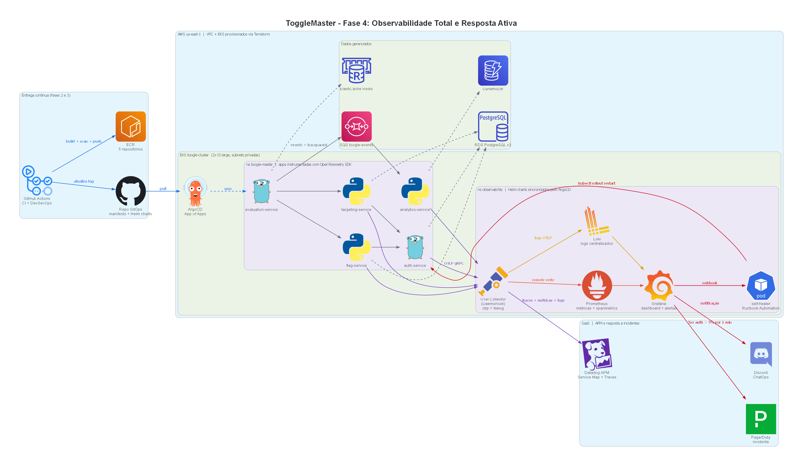

# toogle-master-gitops

Repositório de **GitOps** do ToggleMaster: contém *apenas* manifestos
Kubernetes declarativos (nenhum código de aplicação). É o único repositório
que o ArgoCD observa - o cluster nunca recebe `kubectl apply`/`helm upgrade`
manual nem credenciais de push vindas do CI.

## Estrutura

```
toogle-master-gitops/
├── apps/                          # Fases 2-3: manifests dos 5 microsserviços
│   ├── base/                      # Namespace + Ingress compartilhados
│   ├── auth-service/              # ConfigMap, Service, Deployment (+ variáveis OTEL_*)
│   ├── flag-service/
│   ├── targeting-service/
│   ├── evaluation-service/        # + HPA
│   └── analytics-service/         # + HPA
├── observability/                 # Fase 4: observabilidade e resposta a incidentes
│   ├── values/                    # values dos Helm charts (versionados aqui)
│   │   ├── kube-prometheus-stack.yaml   # Prometheus + Grafana
│   │   ├── loki.yaml
│   │   └── otel-collector.yaml          # roteamento de métricas, logs e traces
│   └── manifests/                 # Kustomize (sincronizado pelo ArgoCD)
│       ├── alerting/              # regra de alerta, contact points e policy (Grafana)
│       ├── dashboards/            # dashboard "ToggleMaster - Saúde do Ecossistema"
│       └── self-healer/           # Runbook Automation (webhook -> rollout restart)
├── argocd/
│   ├── project/toogle-master-project.yaml   # AppProject das aplicações
│   ├── applications/              # 1 Application por componente (App of Apps)
│   │   ├── base.yaml + 5 microsserviços
│   │   ├── observability-project.yaml       # AppProject da stack de observabilidade
│   │   ├── kube-prometheus-stack.yaml       # Helm (multi-source: chart oficial + values daqui)
│   │   ├── loki.yaml
│   │   ├── otel-collector.yaml
│   │   └── observability-config.yaml        # dashboard + alertas + self-healer
│   └── root-app.yaml              # "App of Apps" (bootstrap)
└── docs/
    ├── arquitetura/               # diagrama da Fase 4 (diagram as code)
    └── runbook-auth-5xx.md        # runbook do alerta (linkado na notificação)
```

## Como funciona o fluxo Pull-Based

1. O pipeline de CI de cada microsserviço builda, escaneia e publica a
   imagem no ECR com a tag `v1.0.0-<commit-hash>`.
2. Como último passo do CI (workflow `update-gitops.yml`, no repositório
   `reusable-workflows`), o `image:` do `apps/<serviço>/deployment.yaml`
   **deste repositório** é atualizado e commitado.
3. O **ArgoCD**, rodando dentro do cluster EKS, está continuamente
   observando (`polling` a cada ~3 min, ou via *webhook* do GitHub) este
   repositório. Ele mesmo detecta a mudança e "puxa" (`pull`) o novo
   manifesto - o CI nunca tem credenciais do cluster, nunca faz `kubectl
   apply` diretamente. Isso é o que caracteriza GitOps *pull-based*
   (em oposição a um CD tradicional que faz *push* das mudanças).
4. Com `syncPolicy.automated` (`prune: true`, `selfHeal: true`), qualquer
   divergência entre o Git e o cluster (inclusive uma alteração manual feita
   via `kubectl edit`) é revertida automaticamente para bater com o Git.

## Bootstrap (rodar uma única vez, após o ArgoCD estar instalado)

```bash
# 1. Aplica o AppProject (define o escopo/permissões do projeto no ArgoCD)
kubectl apply -f argocd/project/toogle-master-project.yaml

# 2. Aplica a Application raiz (App of Apps) - a partir daqui o ArgoCD
#    assume a criação/sync de tudo o mais (base + 5 microsserviços)
kubectl apply -f argocd/root-app.yaml
```

Depois disso, para acompanhar:

```bash
kubectl port-forward svc/argocd-server -n argocd 8080:443
# acesse https://localhost:8080 (login: admin / senha do secret argocd-initial-admin-secret)
argocd app list
```

Você deve ver 11 Applications (`toogle-master-base`, 5 microsserviços e 5 da
observabilidade), todas em `Synced`/`Healthy`.

## Por que um repositório separado?

Separar infraestrutura de deploy do código-fonte dos microsserviços é uma
prática central de GitOps: o time de aplicação não precisa (nem deve ter)
acesso de escrita no cluster, e o histórico deste repositório vira a
"fonte da verdade" auditável de tudo que já foi implantado.

## Fase 4: Observabilidade Total e Resposta Ativa



Toda a stack de observabilidade entra no cluster **pelo mesmo fluxo GitOps**: são
Applications do ArgoCD apontando para os Helm charts oficiais, com os `values` versionados
em `observability/values/`. Nada é instalado com `helm install` manual.

| Peça | O que faz |
|---|---|
| **OTel Collector** (DaemonSet) | Recebe OTLP dos 5 serviços e lê os logs de todos os pods (`filelog`). Enriquece com metadados do K8s e roteia: traces para o Datadog, métricas para o Prometheus (remote write) e logs para o Loki. Também manda tudo para o Datadog. O connector `spanmetrics` gera métricas RED a partir dos traces. |
| **Prometheus** | Métricas de infraestrutura (cAdvisor, kube-state-metrics, node-exporter) e das aplicações (via Collector). |
| **Loki** | Logs centralizados e indexados por `k8s_namespace_name`, `k8s_deployment_name` e `service_name`. |
| **Grafana** | Dashboard customizado (recursos do cluster, req/s, erro e latência por serviço, logs ao vivo) e o alerta. |
| **Datadog** | APM: Service Map dos 5 serviços e traces distribuídos. O `datadogconnector` calcula as APM stats dentro do próprio Collector. |
| **PagerDuty + Discord** | Incidente e ChatOps, disparados pelo Grafana Alerting. |
| **Self-healer** | Runbook Automation: recebe o webhook do alerta e faz `rollout restart` no deployment afetado (allowlist + cooldown). |

Decisões importantes:

- **Alertas como código**: regra, contact points e policy ficam em `observability/manifests/alerting`
  e são carregados pelo sidecar do Grafana. As chaves (PagerDuty, Discord, Datadog) ficam
  em Secrets criados pelo `fase4-secrets.ps1`, nunca no Git.
- **Alert fatigue**: o alerta usa taxa (não contagem), exige 1 minuto acima do limite, agrupa
  por serviço e repete no máximo a cada 1h. O self-healer tem cooldown de 5 minutos.
- **ArgoCD x self-healing**: as Applications dos serviços ignoram a annotation `restartedAt`
  (`ignoreDifferences` + `RespectIgnoreDifferences`). Sem isso, o `selfHeal` do ArgoCD
  desfaria o restart do self-healer. Nos serviços com HPA, o `replicas` também é ignorado.
- **Sem volumes persistentes**: o AWS Academy não tem o driver EBS CSI, então Prometheus
  e Loki usam `emptyDir`. Os dados vivem enquanto o cluster existir.

Runbook do incidente: [docs/runbook-auth-5xx.md](docs/runbook-auth-5xx.md).

Tudo o que precisou ser corrigido para a Fase 4 funcionar (CI quebrado, SSRF apontado pelo
gosec, Security Group dos nós do EKS, bancos não inicializados e as correções encontradas
na validação em cluster real): [docs/melhorias-fase4.md](docs/melhorias-fase4.md).
