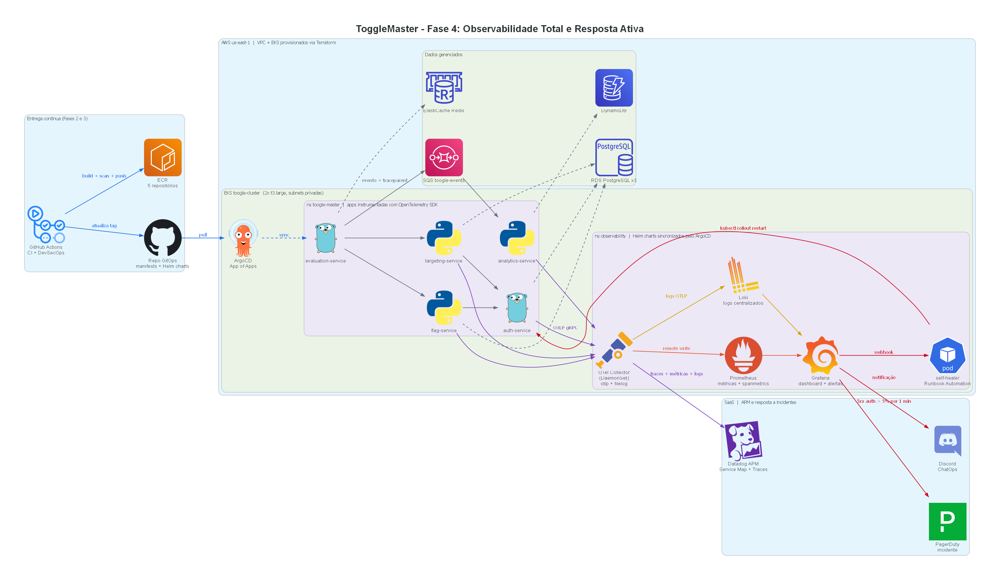

# Roteiro do vídeo e memória de construção: Fase 4

Documento único para a gravação: o que foi construído, o que falar em cada cena, os comandos
exatos, as dificuldades enfrentadas e o plano B se algo quebrar ao vivo.

- **Duração alvo:** 20 minutos (o limite do desafio é 25)
- **Cenário validado ao vivo em:** 23/09/2026, cluster real na AWS
- **MTTR medido:** falha às 14:28:09 → tráfego normalizado às 14:30:20 = **2 min 11 s**, sem intervenção humana

---

## Parte 1: o que foi construído

### 1.1 A dor (use isto na abertura)

O enunciado descreve o problema: o `evaluation-service` começou a falhar **silenciosamente**, a
equipe levou **6 horas para ser avisada pelos usuários** e mais **4 horas procurando a causa raiz
em logs espalhados pelos pods**. Nosso objetivo foi transformar essas 10 horas em minutos, sem
ninguém de plantão olhando gráfico.

### 1.2 A arquitetura



| Camada | O que faz |
|---|---|
| **5 microsserviços** (2 Go, 3 Python) | Instrumentados com o SDK do OpenTelemetry. Mandam traces e métricas por OTLP |
| **OTel Collector** (DaemonSet) | Peça central: recebe OTLP, lê os logs de todos os pods (`filelog`), enriquece com metadados do Kubernetes e roteia cada sinal |
| **Prometheus** | Métricas de infraestrutura e de aplicação (via remote write do Collector) |
| **Loki** | Logs centralizados, indexados por namespace, pod e deployment |
| **Grafana** | Dashboard customizado + o alerta, tudo versionado em Git |
| **Datadog** | APM: Service Map e traces distribuídos |
| **PagerDuty / Discord** | Incidente e ChatOps |
| **Self-healer** | Runbook Automation: recebe o webhook do alerta e executa o `rollout restart` |

### 1.3 As decisões que sustentam a demonstração

1. **Collector como DaemonSet com tráfego local**: cada app fala com o Collector do próprio nó,
   e assim o processador `k8sattributes` descobre de qual pod veio cada sinal.
2. **Connector `spanmetrics`**: as métricas de requisição, erro e latência nascem dos *traces*,
   iguais para Go e Python. Sem isso, o alerta dependeria de nomes de métrica diferentes em
   cada linguagem.
3. **Trace atravessa a fila**: o `evaluation-service` coloca o `traceparent` nos atributos da
   mensagem SQS e o `analytics-service` continua o mesmo trace. É isso que liga os **5** serviços
   no Service Map, e não apenas os 4 que se falam por HTTP.
4. **Tudo como código**: dashboard, regra de alerta, contact points e o self-healer são arquivos
   no repositório GitOps. Destruir e recriar o cluster devolve o ambiente idêntico.
5. **Falha silenciosa de verdade**: o endpoint de caos faz o `/validate` responder 500 enquanto o
   `/health` continua 200. O Kubernetes **não** percebe (nenhuma probe falha); quem percebe é a
   observabilidade. É exatamente o cenário do enunciado.

---

## Parte 2: antes de gravar

```powershell
# 1. Ambiente no ar e sincronizado
kubectl get applications -n argocd          # 11 Applications Synced
kubectl get pods -n toogle-master           # 8 pods Running
kubectl get pods -n observability           # 10 pods Running

# 2. Tráfego rodando (deixe em um terminal visível)
.\fiap_toogle_master_v2\scripts\gerar-trafego.ps1

# 3. Painéis (um terminal cada; use 127.0.0.1, NÃO localhost)
kubectl port-forward svc/argocd-server -n argocd 8085:443
kubectl port-forward svc/kube-prometheus-stack-grafana -n observability 3005:80
```

Abas do navegador, na ordem em que serão usadas: ArgoCD → Grafana (dashboard) → Grafana
(Alerting) → Datadog (Service Map) → Datadog (Traces) → Discord → PagerDuty.

> ⚠ **Cooldown:** o self-healer só reage uma vez a cada 5 minutos por deployment. Se você ensaiou
> a falha, espere 5 minutos antes de gravar a cena do incidente.

---

## Parte 3: roteiro cena a cena

### Cena 1 — O problema (2 min) · diagrama na tela

> "O ToggleMaster já entrega software rápido: pipeline automatizado, infraestrutura como código
> e GitOps. Mas no fim de semana passado o serviço de avaliação começou a falhar em silêncio. A
> equipe só soube **seis horas depois**, pelos usuários, e levou mais **quatro horas** para achar
> a causa nos logs espalhados pelos pods. O objetivo desta fase é que isso nunca mais dependa de
> alguém perceber."

Mostre o diagrama e percorra o caminho do dado: as aplicações mandam OTLP para o **OTel
Collector**, que é a peça central e roteia cada sinal para o destino certo.

### Cena 2 — A base continua de pé (2 min) · terminal + ArgoCD

```powershell
kubectl get nodes
kubectl get applications -n argocd
```

> "As fases anteriores continuam funcionando: o cluster EKS criado por Terraform e o ArgoCD
> sincronizando o repositório. A diferença é que agora são **onze** Applications: as seis das
> aplicações e mais cinco da stack de observabilidade. Ou seja, **o monitoramento entrou pelo
> mesmo fluxo GitOps**, não foi instalado na mão."

Na UI do ArgoCD, abra `otel-collector` e mostre que a origem é o chart oficial com os values
vindos do nosso repositório.

### Cena 3 — Métricas, logs e o papel do OTel (5 min) · Grafana

**3.1 Dashboard** (Dashboards → ToggleMaster → Saúde do Ecossistema)

> "Este dashboard é um arquivo JSON no Git. Em cima, a saúde do cluster: CPU, memória e pods.
> No meio, os microsserviços: requisições por segundo, taxa de erro e latência p95 — e isso não
> vem de métrica que a aplicação publica, vem dos **traces**, convertidos pelo connector
> spanmetrics dentro do Collector. Por isso Go e Python aparecem do mesmo jeito."

**3.2 Logs ao vivo** (painel de logs no fim do dashboard)

> "Embaixo, os logs de todos os pods, centralizados no Loki. O Collector lê o stdout de cada
> contêiner e adiciona namespace, pod e deployment. Aquelas quatro horas procurando log em pod
> viram uma busca só."

**3.3 A configuração do OTel** (mostre `observability/values/otel-collector.yaml`)

> "Aqui está a peça central. Um pipeline para cada sinal: **traces** vão para o Datadog,
> **métricas** para o Prometheus e **logs** para o Loki — e os três também vão para o APM. Trocar
> de ferramenta é trocar um exporter neste arquivo; o código das aplicações não muda. Foi
> exatamente isso que aconteceu quando migramos de New Relic para Datadog no meio do projeto."

### Cena 4 — APM e trace distribuído (4 min) · Datadog

**4.1 Service Map** (APM → Service Map)

> "Aqui estão os cinco serviços e como eles se falam. Repare no analytics: ele não recebe
> chamada HTTP de ninguém, ele consome uma fila SQS. Ele aparece ligado porque colocamos o
> contexto do trace **dentro da mensagem**, e ele continua o mesmo trace do outro lado."

**4.2 Trace distribuído** (APM → Traces → um `GET /evaluate`)

> "Uma requisição de avaliação de flag, de ponta a ponta: o evaluation consulta o cache no Redis,
> chama flag e targeting em paralelo, os dois validam a chave no auth, o auth consulta o
> PostgreSQL, e no fim o evento vai para a fila e é gravado no DynamoDB. Cada barra é um span,
> com a duração real."

**4.3 Correlação log ↔ trace**

> "E dentro do próprio trace eu tenho os logs daquela requisição. Como os logs saem do stdout do
> pod, o `trace_id` vinha só no texto; um processador no Collector promove esse ID para o campo
> do registro, e é isso que liga log e trace nos dois sentidos."

### Cena 5 — A prova real (6 min) · 4 terminais + navegador

Deixe visível: terminal do tráfego, `kubectl get pods -l app=auth-service -w`,
`kubectl logs -f deploy/self-healer -n observability`, e o terminal onde você injeta a falha.

```powershell
.\fiap_toogle_master_v2\scripts\simular-falha.ps1
```

> "Vou injetar uma falha **silenciosa** no auth-service: ele passa a responder 500 nas
> validações, mas o `/health` continua respondendo 200. O Kubernetes não vai perceber nada,
> porque nenhuma probe falha. É o cenário do enunciado."

Narre nesta ordem, conforme acontece:

| Momento | O que mostrar | O que dizer |
|---|---|---|
| imediato | terminal do tráfego | "auth em 500; flag e targeting já caíram para 401 e a avaliação para 502: a falha se propagou" |
| ~30 s | dashboard do Grafana | "a taxa de 5xx cruzou a linha vermelha do limite de 5%" |
| ~1 min | Alerting → Alert rules | "Pending: ele exige 1 minuto acima do limite, para não disparar por pico isolado" |
| ~2 min | Discord e PagerDuty | "Firing: incidente aberto no PagerDuty e mensagem detalhada no Discord, com a taxa medida, a ação automática e o link do runbook" |
| segundos depois | log do self-healer | "o mesmo alerta chamou um webhook interno; ele conferiu a allowlist e o cooldown e executou o runbook: rollout restart no auth-service" |
| ~10 s depois | terminal dos pods | "pod novo no ar, o antigo terminando. A falha estava na memória do processo, então o restart resolve" |
| ~20 s depois | tráfego + Discord | "tudo 200 de novo; o self-healer avisou que concluiu e o alerta resolveu sozinho, fechando o incidente no PagerDuty" |

> **Feche a cena com o número:** "Da falha à recuperação: **2 minutos e 11 segundos**, sem
> ninguém ser acordado. No cenário do enunciado, foram dez horas."

### Cena 6 — Decisões e dificuldades (3 min)

Fale de 3 a 4 destes itens (todos estão detalhados em [melhorias-fase4.md](melhorias-fase4.md)):

1. **Datadog x New Relic**: começamos com New Relic, mas a conta gratuita teve a ingestão
   bloqueada (HTTP 403 em todos os endpoints, inclusive numa conta nova). Como o código só
   conhece o OpenTelemetry, a migração foi trocar **um exporter** no Collector. Isso provou na
   prática o argumento de não ficar preso a agente proprietário.
2. **PagerDuty x OpsGenie**: a Atlassian encerrou a venda do OpsGenie para novos clientes, então
   não havia como criar conta.
3. **Alert fatigue**: o alerta usa taxa e não contagem, exige 1 minuto acima do limite, agrupa
   por serviço e repete no máximo a cada hora; ausência de tráfego não é incidente. E o
   self-healer tem allowlist e cooldown, para automação não virar "restart em loop".
4. **ArgoCD contra o self-healing**: o `selfHeal` do ArgoCD desfazia o restart da automação e
   causava um segundo rollout. Resolvido com `ignoreDifferences` na annotation `restartedAt`.
5. **O Security Group que não era o que parecia**: os pods não conseguiam falar com o RDS. O node
   group gerenciado recebe a SG criada pelo próprio EKS, e não a nossa; como o pod usa o ENI do
   nó, era essa SG que precisava de liberação. Corrigido no Terraform, não na mão.
6. **DevSecOps encontrou uma falha real**: o gosec apontou SSRF (CWE-918) no evaluation-service,
   porque o nome da flag vinha do usuário e virava caminho de URL. Corrigimos com allowlist,
   escape e validação com retorno 400.

---

## Parte 4: dificuldades enfrentadas (resumo para o relatório)

| # | Dificuldade | Como foi resolvida |
|---|---|---|
| 1 | 4 dos 5 pipelines estavam quebrados (herdado da Fase 3) | Formatação Ruff, troca de `io/ioutil`, golangci-lint v2 e correção das referências após a conta do GitHub ser renomeada |
| 2 | Ingestão do New Relic bloqueada | Migração para o Datadog trocando um exporter |
| 3 | Pods sem acesso ao RDS/Redis | Regras de SG liberando a SG gerenciada do EKS, no Terraform |
| 4 | Bancos e secrets nunca eram criados | `fase4-secrets.ps1`, idempotente, com pods `psql` dentro do cluster |
| 5 | Stack não cabia em `t3.medium` | Node group para `t3.large` (limite de pods e memória) |
| 6 | Conta do AWS Academy muda entre sessões | Procedimento documentado; bucket do state e URLs do ECR parametrizados |
| 7 | Alerta chegava com o template literal no Discord | O `$` das anotações não devia ser escapado como `$$` |
| 8 | `analytics-service` não subia | A instrumentação do `requests` era obrigatória e esse serviço não usa a lib |
| 9 | Gerador de tráfego travava durante o restart | `--max-time` nos `curl` |
| 10 | SSRF apontado pelo SAST | Allowlist, `url.PathEscape` e resposta 400 |

---

## Parte 5: plano B durante a gravação

| Se acontecer | Faça |
|---|---|
| O alerta não dispara em 2 min | Confirme que o tráfego está rodando (`kubectl logs trafego -n toogle-master --tail=3`). Sem tráfego não há taxa, e `noDataState: OK` é proposital |
| O self-healer não age | Provavelmente é o cooldown de 5 min. O log mostra `Cooldown ativo`. Espere e repita |
| Pod em `ImagePullBackOff` | O CI ainda não publicou a imagem. `gh run list -R leonardopetruncko/<serviço> -L 1` |
| Port-forward caiu | Refaça o comando; use `127.0.0.1`, não `localhost` |
| Precisa desligar a falha na mão | `.\fiap_toogle_master_v2\scripts\simular-falha.ps1 -Desligar` |

---

## Parte 6: checklist dos entregáveis

- [ ] **Código**: IaC/GitOps com a stack de monitoramento e o OTel Collector
- [ ] **Código**: aplicações instrumentadas
- [ ] **Código**: automação de self-healing
- [ ] **Vídeo**: cluster e ArgoCD rodando com a stack nova (Cena 2)
- [ ] **Vídeo**: dashboard, busca de logs no Loki e explicação do roteamento do OTel (Cena 3)
- [ ] **Vídeo**: Service Map e trace distribuído no APM (Cena 4)
- [ ] **Vídeo**: alerta disparando, incidente no PagerDuty, ChatOps e self-healing (Cena 5)
- [ ] **Relatório**: nomes, RMs e usernames
- [ ] **Relatório**: links do repositório e do vídeo
- [ ] **Relatório**: 4 prints obrigatórios (dashboard, trace, ChatOps, log do self-healing)
- [ ] **Relatório**: justificativa técnica (arquitetura OTel, Datadog x New Relic, PagerDuty x OpsGenie)
